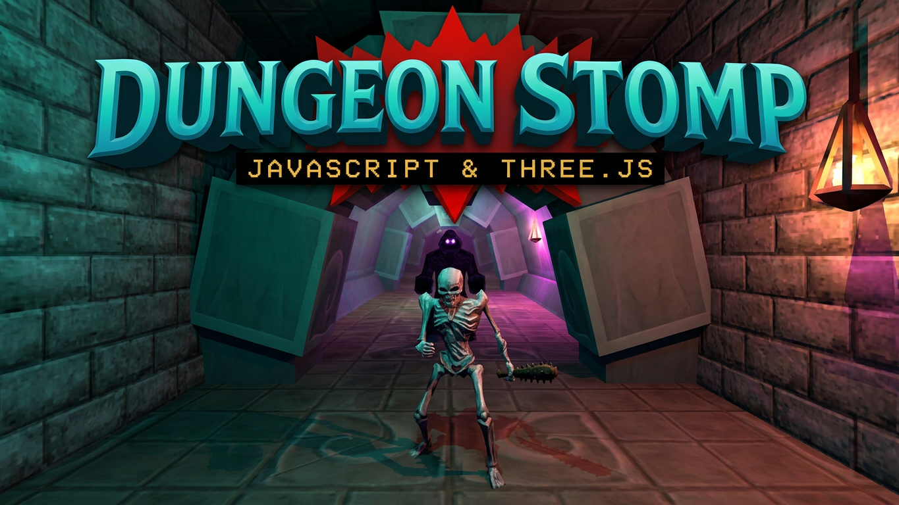

<div align="center">

# ⚔️ Dungeon Stomp (Godot 4.7.2)

### A classic 3D first-person dungeon crawler rebuilt natively for Godot Engine 4.7.2.

**Procedural Dungeons · Real-Time Combat · 30 Monster Families · Godot 4 Forward+ · Pure GDScript · Native Windows Desktop**


<br>



</div>

---

## 📖 Overview

**Dungeon Stomp (Godot)** is a complete, native first-person 3D dungeon crawler built from the ground up for **Godot 4.7.2** using pure **GDScript**. It is a modern engine revival of the classic Direct3D dungeon crawler by [Mark Longo (moonwho101)](https://github.com/moonwho101), faithfully recreating the original gameplay, levels, models, textures, and sounds with modern engine capabilities.

Everything runs natively in Godot with zero external plugin dependencies: original level maps, object definitions, Quake II MD2 animated meshes with GPU vertex interpolation, 3DS models, and sound tables are parsed directly at runtime.

Swing a flaming sword, hurl fireballs, cast lightning, and stomp through endless **procedurally generated dungeons** crawling with monsters, traps, and treasure.

---

## ✨ Features

- 🏰 **Infinite Procedural Dungeons:** Generate complete dungeons on the fly with seedable layouts, configurable room counts, corridors, teleporters, doors, and exit portals. Descend deeper into the dungeon where monsters grow stronger and rewards grow greater.
- ⚔️ **Real-Time Combat & Full Arsenal:** 10 distinct melee weapons (Axe, Flamesword, Bastard Sword, Battle Axe, Ice Sword, Lightning Sword, Morning Star, Spiked Flail, Split Sword, and Super Flamesword) with authentic first-person bobbing, swinging animations, and impact effects.
- 🔮 **Spellcasting System:** Cast devastating real-time spells including **Magic Missile**, **Fireball**, **Lightning**, and **Healing** with physics-driven projectile trajectories and splash damage.
- 🧟 **30 Monster Families:** Ogres, hydras, dragons, necromancers, demonesses, faeries, mummies, wraiths, goblins, skeletons, wolves, tentacle horrors, and more. Features state-machine AI with patrol, pursuit, melee attacks, and ranged spellcasting.
- 💡 **Godot Forward+ 3D Rendering:** Dynamic lighting with flickering lamp glare, normal map support (`ds_normal_maps` shader global), particle effects for blood splatters and spell bursts, and atmospheric distance fog.
- 🧭 **Retro HUD & Radar Minimap:** Circular real-time radar minimap tracking surrounding walls, monsters, and loot. Polished HUD displaying health, XP, dungeon depth, kill counts, and active equipment.
- 💾 **Persistent Adventure State:** Automatically saves run progress to `user://` — slain monsters, looted chests, unlocked doors, and player stats persist across sessions and depth transitions.
- 🎮 **Full Input & Controller Support:** Native keyboard/mouse and gamepad support (Xbox, PlayStation DualSense/DualShock, Nintendo Switch Pro) with analog movement, stick aiming, haptics/rumble, and menu navigation.

---

## 🏗️ Architecture & Godot Engine Implementation

The game is written in pure GDScript and organized into modular engine subsystems:

| Script | Subsystem | Description |
|--------|-----------|-------------|
| [scripts/game.gd](scripts/game.gd) | **Core Game Loop** | Main game state, scene initialization, player controller, weapon switching, combat resolution, and save/load serialization. |
| [scripts/generator.gd](scripts/generator.gd) | **Procedural Generator** | Deterministic dungeon layout generator with seeded RNG, room carving, corridors, door placement, and monster/loot distribution. |
| [scripts/parsers.gd](scripts/parsers.gd) | **Classic File Parsers** | Runtime binary and text parsers for classic `.map` levels, `Objects.dat` geometry, `modellist.dat`, `textures.dat`, and `.snd` files. |
| [scripts/md2.gd](scripts/md2.gd) | **MD2 Model Engine** | Custom Quake II MD2 parser with GPU vertex-animation blending and mesh instantiation for monsters and weapons. |
| [scripts/tds.gd](scripts/tds.gd) | **3DS Model Loader** | Custom binary 3D Studio (`.3ds`) parser that constructs Godot `ArrayMesh` resources on the fly. |
| [scripts/collision.gd](scripts/collision.gd) | **Custom Physics & Collision** | Spatial-partitioned 3D grid with capsule-world collision response, gravity, stairs climbing, and line-of-sight raycasts. |
| [scripts/monster.gd](scripts/monster.gd) | **Monster AI** | Finite state machine for monster behaviors (patrol, aggro, pursuit, melee attack, spellcasting, pain, and death). |
| [scripts/materials.gd](scripts/materials.gd) | **Materials & Shaders** | Material generator matching classic lighting, normal mapping, diffuse blending, and transparency. |
| [scripts/effects.gd](scripts/effects.gd) | **Visual FX & Lighting** | Dynamic point lights, flickering torch effects, blood splatters, spell projectile trails, and floating combat text. |
| [scripts/ui.gd](scripts/ui.gd) | **User Interface** | Main menu, Options menu, Dungeon Generator menu, HUD bars, toast notifications, and death screen. |
| [scripts/minimap.gd](scripts/minimap.gd) | **Circular Radar Minimap** | Custom 2D minimap renderer drawing walls, doors, chests, exit portals, monsters, and player orientation. |
| [scripts/audio.gd](scripts/audio.gd) | **Audio Manager** | Sound effect playback, 3D positional audio, looping ambient tracks, and MIDI music management. |
| [scripts/gamepad.gd](scripts/gamepad.gd) | **Gamepad Controller** | Controller detection, deadzone curve mapping, smooth stick look, trigger actions, rumble vibration, and menu navigation. |
| [scripts/data_paths.gd](scripts/data_paths.gd) | **Asset Discovery** | Cross-platform resolution of `Assets/`, `bin/`, `Sounds/`, and `Midi/` runtime data directories. |

---

## 🚀 Getting Started

### Prerequisites

- **[Godot Engine 4.7.2](https://godotengine.org/download)** (Standard 64-bit build recommended)
- **Windows 10 / 11** (x86_64)

### Running in the Godot Editor

1. Clone this repository:
   ```bash
   git clone https://github.com/moonwho101/DungeonStompGodot.git
   cd DungeonStompGodot
   ```
2. Launch Godot 4.7.2 and click **Import**.
3. Select the [project.godot](project.godot) file and choose **Import & Edit**.
4. Press **F5** (or click the **Play** button in the top-right corner) to run [scenes/main.tscn](scenes/main.tscn).

### Running the Standalone Windows Executable

The repository includes pre-built Windows desktop binaries:

- `DungeonStomp.exe` — The main game executable.
- `DungeonStomp.console.exe` — Windows console wrapper for debugging and log output.

> **Note:** The game data folders ([Assets/](Assets/), [bin/](bin/), [Sounds/](Sounds/), [Midi/](Midi/)) are loaded dynamically at runtime and must remain in the same folder as the executable.

### Exporting Windows Desktop Builds

You can export a fresh Windows build from the command line using Godot 4.7.2:

```bash
mkdir -p build/windows
godot --headless --path . --export-debug "Windows Desktop" build/windows/DungeonStomp.exe
```

Copy the runtime data folders alongside the exported binary:
```bash
cp -r Assets bin Sounds Midi build/windows/
```

### Running Automated Headless Tests

Run the headless test suite to verify parsers, collision math, model loaders, and dungeon generation:

```bash
godot --headless --path . -s res://tests/test_runner.gd
```

---

## 🎮 Controls

### Keyboard & Mouse

| Key / Input | Action |
|-------------|--------|
| `W` `A` `S` `D` / Arrow keys | Move / Strafe |
| Mouse | Look around (click window to capture cursor) |
| Left Mouse Button | Attack with weapon / cast active spell |
| `Space` | Jump (or fly up in fly mode) |
| `Shift` | Sprint |
| `Q` / `Z` | Next / previous weapon or spell |
| `E` | Open nearby door / interact with chest |
| `G` | Generate a new procedural dungeon level |
| `N` | Toggle normal mapping |
| `P` / `M` | Toggle music on/off |
| `F` / `V` | Toggle fly mode (noclip exploration) |
| `C` / `Ctrl` | Fly down (while in fly mode) |
| `I` | Cheat: Toggle God Mode (invincibility) |
| `K` | Cheat: Unlock all weapons & bonus spells |
| `Esc` | Pause / open menu / release mouse cursor |

### Gamepad / Controller

| Controller Input | Action |
|------------------|--------|
| **Left Stick** | Move / Strafe |
| **Right Stick** | Look around |
| **Right Trigger (RT)** | Attack / cast spell |
| **Left Trigger (LT)** / **L3** | Sprint |
| **A Button** | Jump (or fly up in fly mode) |
| **B Button** | Fly down (in fly mode) |
| **X Button** | Interact / open door / open chest |
| **Right Bumper (RB)** / **Y** / **D-Pad Right** | Next weapon or spell |
| **Left Bumper (LB)** / **D-Pad Left** | Previous weapon or spell |
| **R3 (Right Stick Click)** | Recenter camera pitch |
| **Start** | Pause / toggle menu |
| **Back / Select** | Cheat: Toggle God Mode |
| **D-Pad Up** | Toggle music on/off |
| **D-Pad Down** | Toggle normal mapping |

---

## 📁 Project Structure

```text
DungeonStompGodot/
├── Assets/                 # MD2 meshes, 3DS models, textures, and normal maps (.gdignore)
├── bin/                    # Classic level maps (.map), Objects.dat, modellist.dat, textures.dat
├── Midi/                   # Classic MIDI background soundtracks (.gdignore)
├── Sounds/                 # Sound effects and ambient audio loops (.gdignore)
├── scenes/
│   └── main.tscn           # Main game scene
├── scripts/
│   ├── audio.gd            # Sound and music manager
│   ├── collision.gd        # 3D spatial collision grid and capsule physics
│   ├── data_paths.gd       # Runtime asset directory locator
│   ├── effects.gd          # Lighting, particles, and floating combat text
│   ├── game.gd             # Main game loop, player, and world management
│   ├── gamepad.gd          # Gamepad input and vibration support
│   ├── generator.gd        # Seeded procedural dungeon generator
│   ├── materials.gd        # Dynamic material creation and shaders
│   ├── md2.gd              # Quake II MD2 loader with GPU vertex blending
│   ├── minimap.gd          # 2D circular radar minimap
│   ├── monster.gd          # Monster AI and combat state machine
│   ├── parsers.gd          # Classic binary/text file format parsers
│   ├── tds.gd              # 3D Studio (.3ds) mesh loader
│   └── ui.gd               # HUD, menus, and on-screen messages
├── tests/
│   └── test_runner.gd      # Headless automated test suite
├── tools/                  # Asset conversion and analysis utilities
├── verification/           # Verification scripts and screenshot captures
├── export_presets.cfg      # Godot Windows Desktop export configuration
├── project.godot           # Godot engine project configuration
├── DungeonStomp.exe        # Pre-built Windows desktop binary
└── README.md
```

---

## 🔗 Related Projects & History

- **Original Game:** *Dungeon Stomp*, the classic Direct3D dungeon crawler developed by [Mark Longo (moonwho101)](https://github.com/moonwho101).
- **Web Version:** For the browser-based WebGL port, see the [DungeonStompThreejs](https://github.com/moonwho101/DungeonStompThreejs) repository or [play it live online](https://moonwho101.github.io/DungeonStompThreejs/).

---

## 📜 License

Released under the [MIT License](LICENSE). © Mark Longo.
