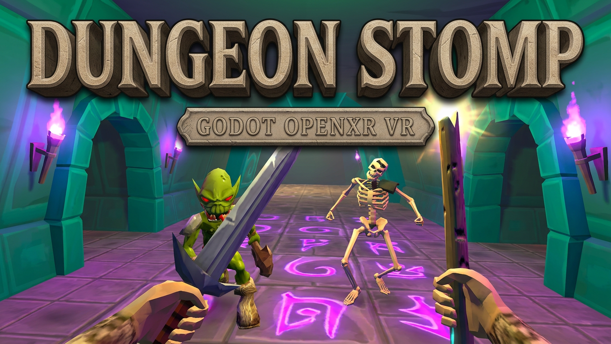

<div align="center">

# ⚔️ DUNGEON STOMP ⚔️

### Swing a sword. Hurl a fireball. Hear the monster before you see it.
**A first-person VR dungeon crawler for your browser, Meta Quest 3, and PC.**

## 🔥 [▶ PLAY NOW IN WEBXR — FREE, IN YOUR BROWSER](https://moonwho101.github.io/DungeonStompGodot/) 🔥

**No download. No sideloading. No account.** Open the link in **Meta Quest Browser**, press **Enter VR**, and descend.

### 🥽 [Now available on SideQuest for Meta Quest](https://sidequestvr.com/app/64231/dungeon-stomp)

### 🧊 [Also play the Three.js version in your browser](https://moonwho101.github.io/DungeonStompThreejs/) · [source code](https://github.com/moonwho101/DungeonStompThreejs)

[](https://moonwho101.github.io/DungeonStompGodot/)
[](https://sidequestvr.com/app/64231/dungeon-stomp)
[](#-meta-quest-3--native-apk)
[](#-windows-desktop--pcvr)
[](https://godotengine.org)
[](LICENSE)



**[Features](#%EF%B8%8F-why-youll-want-to-play-it)** · **[WebXR](#-webxr--play-in-the-browser)** · **[Quest 3](#-meta-quest-3--native-apk)** · **[Windows](#%EF%B8%8F-windows-desktop--pcvr)** · **[Project tour](#-project-tour)** · **[History](#-from-directx-7-to-a-tracked-sword)**

</div>

> *You hear a sorcerer muttering around the corner. A goblin's cackle echoes from the left, exactly where it's standing. You raise your hand and ready a Fireball for the far end of the hall... or close the distance and swing.*

**Dungeon Stomp** is [Mark Longo](https://github.com/moonwho101)'s first-person dungeon crawler, first written in C++ and DirectX 7 in 2001 and rebuilt from the ground up in **Godot 4**. The classic monsters, maps, and sounds now share the dungeon with procedurally generated levels, monsters with personalities, 3D positional audio, and **a sword that follows your actual hand**.

---

## 🗡️ Why you'll want to play it

| | |
|---|---|
| 🥽 **Real VR melee** | Your sword strikes only when its blade crosses a monster mid-swing. It reads the motion of your hand, not a button press. |
| 🌐 **Plays in the browser** | WebXR runs on Quest straight from a URL. Share the link and your friends are in the dungeon without installing anything. |
| 👹 **30 monster types** | Goblins, skeletons, mummies, wraiths, ogres, centaurs, hydras, necromancers, demonesses, dragons, and more. Deeper levels bring nastier creatures. |
| 🧠 **Monsters with personalities** | Each monster has one of 8 temperaments: **Brute, Berserker, Coward, Cunning, Show-off, Pack Leader, Drowsy, and Vigilant**. A wounded coward runs. A pack leader brings friends. Spellcasters keep their distance and fire back. |
| 🔮 **Steel and sorcery** | Ten melee weapons, from the starting Axe to the **Super Flame Sword**, plus four spells: **Magic Missile, Fireball, Lightning, and Healing**. |
| 🎲 **Endless dungeons** | Seeded procedural generator: pick a seed and room count, or let it roll. The same seed builds the same dungeon every time. |
| 🔊 **Hear them first** | Positional audio tells you where every growl, footstep, and spell is coming from. |
| 📈 **RPG progression** | Loot chests and barrels, drink potions, collect goblets, scrolls, and spellbooks, earn XP, and level up for more max HP. |
| 💾 **Pick up where you left off** | **Resume** restores your stats, gear, opened doors, looted chests, and slain monsters. |

---

## 🏰 Your first descent

1. **Explore.** Start a new game, or open the **Dungeon Generator** and pick a seed and room count. Check side rooms for chests and listen before you open the next door.
2. **Fight and loot.** Use an axe or sword up close, and switch to Magic Missile, Fireball, or Lightning at range. Watch how enemies react. Drink potions, eat cheese, and hunt for the mushroom that fully restores your health.
3. **Find the portal.** The blue arrow on the radar minimap points to the exit. When it becomes a pulsing target, you're close. Step through to descend, where the monsters get meaner.

---

## 🌐 WebXR — play in the browser

### **👉 [moonwho101.github.io/DungeonStompGodot](https://moonwho101.github.io/DungeonStompGodot/) 👈**

1. On your Quest, open **Meta Quest Browser** and go to the link above.
2. Wait for the dungeon to load, then press **Enter VR** on the main menu.
3. Allow the immersive session when asked. You're in.

Without a headset, the same page plays as a flat-screen game with keyboard and mouse. The **Enter VR** button tells you if your browser doesn't support immersive VR.

**Prefer a pure browser game?** Try [Dungeon Stomp Three.js on itch.io](https://moonwho101.itch.io/dungeon-stomp-threejs), a separate JavaScript/WebGL edition. There's also a [WebXR build on itch.io](https://moonwho101.itch.io/dungeon-stomp-vr).

<details>
<summary><strong>🔧 Under the hood: the Web export</strong></summary>

- The **`DungeonStomp`** preset (capital D and S) targets **Web** and exports to [docs/](docs/), which GitHub Pages serves directly. Rebuild the live site with:

  ```powershell
  godot --headless --path . --export-release "DungeonStomp" docs/index.html
  ```

- The web build is single-threaded, with extension support and PWA mode disabled, and uses Godot's Compatibility renderer. Immersive WebXR needs HTTPS and a user gesture, and GitHub Pages provides HTTPS.
- The [XR rig](scripts/xr_rig.gd) is created when the WebXR session starts. It reads the browser's standard `thumbstick` / `thumbstick_click` inputs, and the buttons match the native Quest controls. Leaving the headset session returns you to the paused desktop menu.
- The [data export plugin](addons/data_export/plugin.gd) packs `Assets/`, `bin/`, and `Sounds/` into the web PCK, which [DataPaths](scripts/data_paths.gd) reads from `res://`. `Midi/` is left out to keep the PCK under GitHub's 100 MB per-file limit, so the web build has sound effects but no music.
- In a browser window, the menu scales up to 3× with sharp MSDF text. Inside the headset, it keeps its normal VR size.

</details>

---

## 🥽 Meta Quest 3 — native APK

For the full-fidelity standalone experience, **[install Dungeon Stomp from SideQuest](https://sidequestvr.com/app/64231/dungeon-stomp)**, or build and sideload the native Android version yourself. Look around with your head, move with the left stick, and turn with the right. **Your right controller is your weapon.** Equip a spell, and the same hand becomes your aim.

| Quest control | Action |
|---|---|
| **Swing the right controller** | Strike with the equipped melee weapon |
| Right trigger | Cast the equipped spell / select on the floating menu |
| Left stick / click | Move toward where you're looking / toggle sprint |
| Right stick ← → | Smooth turn |
| A / B | Jump / open a door or chest |
| X / Y | Previous / next weapon or spell |
| Left trigger or left menu button | Pause / resume |

**Build and install:** Open [project.godot](project.godot) in Godot **4.7.2**, install the matching export templates, and set the Android SDK and Java SDK paths. In **Project → Export**, choose **`dungeonstomp`** (lowercase) and export a debug APK. With Developer Mode enabled on your Quest and USB debugging authorized, run:

```sh
adb install -r "Dungeon Stomp.apk"
```

Launch **Dungeon Stomp** from **Unknown Sources**. After installation, it needs no PC connection.

<details>
<summary><strong>🔧 Under the hood: the Quest build</strong></summary>

- **Package:** A Gradle-built `arm64-v8a` APK with XR mode enabled.
- **Rendering:** Godot's Mobile renderer (Vulkan). The [OpenXR rig](scripts/xr_rig.gd) requests **90 Hz** when available, renders at **1.25×** the runtime's recommended per-eye resolution, and enables dynamic foveation.
- **Tracking:** One tracked meter maps to 60 dungeon units. Swing speed is measured relative to your head, so walking forward with a still sword doesn't count as a swing. Each swing can hit a given monster only once.
- **Data:** The [data export plugin](addons/data_export/plugin.gd) packs `Assets/`, `bin/`, `Sounds/`, and `Midi/` into the APK, so there's nothing extra to copy to the headset.

</details>

---

## 🖥️ Windows desktop & PCVR

Open [project.godot](project.godot) in Godot **4.7.2** and press **F5**. Click the window to capture the mouse.

| Keyboard & mouse | Gamepad | Action |
|---|---|---|
| **WASD** / arrows | Left stick | Move |
| Mouse | Right stick | Look |
| **Left-click** | Right trigger | Attack / cast |
| **Shift** | Left stick click | Sprint |
| **Space** | A | Jump |
| **E** | X | Open a door or chest |
| **Q / Z** | Bumpers / D-pad ← → | Cycle weapons and spells |
| **Esc** | Start | Pause / resume |
| **G** | — | Generate a brand-new dungeon |
| **F** | — | Toggle fly mode (Space / C to rise and sink) |
| **M** · **H** · **N** | D-pad ↑ · — · D-pad ↓ | Toggle music · HUD · normal maps |

**Distribute a Windows build** with the **`Windows Desktop`** preset. It produces an x86-64 `DungeonStomp.exe` with an embedded PCK. The classic data still loads from disk, so ship these folders next to the executable:

```text
DungeonStomp.exe
Assets/
bin/
Sounds/
Midi/
```

If an OpenXR runtime and headset are active, Windows starts in **PCVR**. To force the flat-screen view, launch `DungeonStomp.exe -- --no-xr`.

---

## 🧱 Project tour

| Path | What lives there |
|---|---|
| [scripts/game.gd](scripts/game.gd) | Main controller: world building, player, combat, items, saving, and the frame loop |
| [scripts/monster.gd](scripts/monster.gd) | Monster AI states, personalities, spellcasting, and stats |
| [scripts/generator.gd](scripts/generator.gd) | Seeded procedural dungeon generator using the same RNG as the browser edition |
| [scripts/xr_rig.gd](scripts/xr_rig.gd) | OpenXR/WebXR rig, hand-tracked melee, and VR controls |
| [scripts/md2.gd](scripts/md2.gd) · [scripts/tds.gd](scripts/tds.gd) · [scripts/parsers.gd](scripts/parsers.gd) | Runtime loaders for Quake II MD2 models, 3D Studio props, and classic level data |
| [scripts/effects.gd](scripts/effects.gd) · [scripts/materials.gd](scripts/materials.gd) | Dynamic lights, particles, blood, floating text, and PBR materials |
| [scripts/audio.gd](scripts/audio.gd) | Positional sound effects and MIDI music |
| [scripts/ui.gd](scripts/ui.gd) · [scripts/minimap.gd](scripts/minimap.gd) | Menus, HUD, and radar minimap |
| [scripts/gamepad.gd](scripts/gamepad.gd) · [scripts/collision.gd](scripts/collision.gd) | Gamepad input and world collision |
| [addons/data_export/](addons/data_export/) | Packs raw game data into Android and Web PCKs |
| [docs/](docs/) | Live WebXR build served by GitHub Pages |
| [tests/](tests/) | Headless unit tests |
| [tools/](tools/) | Python asset and level tooling |

### Run the tests

```powershell
godot --headless --xr-mode off --path . -s res://tests/test_runner.gd
```

`--xr-mode off` keeps the headless run from waiting on an XR runtime.

---

## 📜 From DirectX 7 to a tracked sword

**[Mark Longo](https://github.com/moonwho101)** (**moonwho101** on GitHub and [itch.io](https://moonwho101.itch.io/)) began the [original Dungeon Stomp](https://github.com/moonwho101/DungeonStomp) in **2001**, writing it in C++ with Direct3D 7, DirectInput, and DirectSound. The first public beta shipped in **August 2002**, and the source was released under the MIT license in **2021**.

| Era | Edition |
|---|---|
| 2001–2002 | [Dungeon Stomp](https://github.com/moonwho101/DungeonStomp): C++ / DirectX 7 |
| Remaster | [Dungeon Stomp DirectX 12](https://github.com/moonwho101/DungeonStompDirectX12): physically based materials |
| Browser | [Dungeon Stomp Three.js](https://github.com/moonwho101/DungeonStompThreejs): JavaScript / WebGL |
| **Now** | **Dungeon Stomp Godot: Quest 3, WebXR, and Windows** ⬅ you are here |

This edition keeps that lineage in the files themselves. GDScript reads the [classic level data](scripts/parsers.gd), [Quake II–format MD2 characters and weapons](scripts/md2.gd), and [3D Studio props](scripts/tds.gd) at runtime. The sword you swing in VR is still the same MD2 model from two decades ago. The difference is that your hand now supplies the motion.

---

<div align="center">

### ⚔️ [ENTER THE DUNGEON](https://moonwho101.github.io/DungeonStompGodot/) ⚔️

⭐ **If you enjoyed the descent, star the repo. It helps more adventurers find the dungeon.** ⭐

[MIT License](LICENSE) · [Model artists & credits](https://github.com/moonwho101/DungeonStomp#-model-credits) · [Export presets](export_presets.cfg) · [More games on itch.io](https://moonwho101.itch.io/)

</div>
