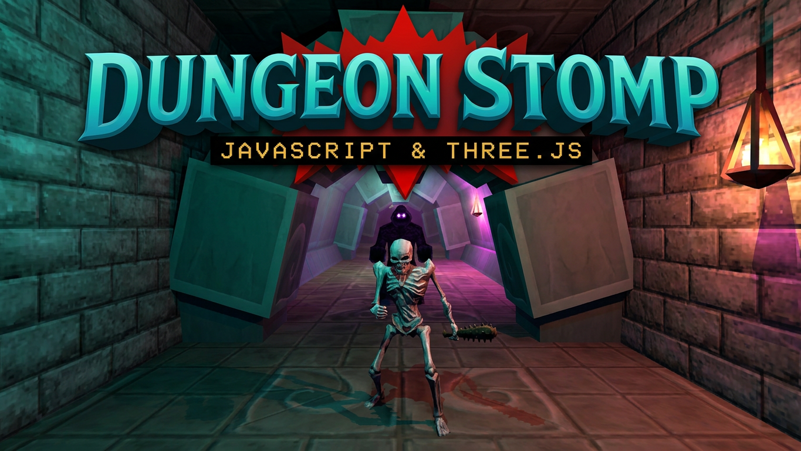

# Dungeon Stomp

Hear a sorcerer around the corner. Ready a spell for the far end of the hall, or close the distance and swing. **Dungeon Stomp** is Mark Longo's first-person dungeon crawler, rebuilt in Godot for standalone **Meta Quest 3** VR and Windows desktop. Its original monsters, maps, and sounds share a dungeon with seeded levels, positional audio, and a sword that follows your hand.

**[Build the native Quest 3 edition](#meta-quest-3--native-android)** · **[Play WebXR on itch.io](https://moonwho101.itch.io/dungeon-stomp-vr)** · **[Play in a regular browser on itch.io](https://moonwho101.itch.io/dungeon-stomp-threejs)** · **[Run on Windows](#windows-desktop)**



## Your first descent

1. **Explore.** Start a new game, or choose a seed and room count in the Dungeon Generator. Check side rooms for chests. Listen before opening the next door: a monster's call comes from its position in the dungeon.
2. **Fight and loot.** Use an axe or sword up close; switch to Magic Missile, Fireball, or Lightning at range. Watch how enemies react: a wounded goblin can flee, while an alerted skeleton can bring its pack into the fight.
3. **Find the portal.** The blue arrow on the minimap points toward the exit. When it turns into a pulsing target, you're close. Step through to descend a level. **Resume** brings back your stats and gear, along with the doors you opened, chests you looted, and monsters you defeated.

## Meta Quest 3 — native Android

**Choose the native APK for standalone play on the headset.** Look around with your head, move with the left stick, and turn with the right. Your right controller holds the weapon: a sword hits when its blade crosses a monster during a swing, not when you press a button. Equip a spell instead and the same hand becomes your aim.

| Quest control | Action |
|---|---|
| Swing the right controller | Strike with the equipped melee weapon |
| Right trigger | Cast the equipped spell, or select an item on the floating menu |
| Left stick / click | Move relative to where you're looking / toggle sprint |
| Right stick left or right | Smooth turn |
| A / B | Jump / open a door or chest |
| X / Y | Previous / next weapon or spell |
| Left trigger or left menu button | Pause or resume |

**Build and install.** Import [project.godot](project.godot) in Godot **4.7.2**, install matching export templates, and configure Godot's Android SDK and Java SDK paths. In **Project → Export**, select **`dungeonstomp`** (lowercase) and export a debug APK. With Developer Mode enabled on your Quest and USB debugging authorized, install it from the export directory:

```sh
adb install -r "Dungeon Stomp.apk"
```

Launch **Dungeon Stomp** from **Unknown Sources** on the headset. No PC connection is needed to play after installation.

<details>
<summary><strong>Inside the Quest export: rendering, tracking, and game data</strong></summary>

- **Package:** The Android preset uses Gradle to build an `arm64-v8a` APK with XR mode enabled. The project version is `1.0.0`; the Android version code is `1`.
- **Rendering:** The project selects Godot's Mobile renderer (Vulkan). The [OpenXR rig](scripts/xr_rig.gd) requests **90 Hz** when available and renders at **1.25×** the runtime's recommended per-eye dimensions. Dynamic foveation is enabled to reduce work away from the center of the view. These are settings, not a measured frame rate.
- **Tracking:** The rig maps one tracked meter to 60 dungeon units. It measures the hand's movement relative to the head, so walking forward with a stationary sword doesn't count as a swing. Each swing can hit a given monster only once.
- **Data:** The [data export plugin](addons/data_export/plugin.gd) packs the raw `Assets/`, `bin/`, `Sounds/`, and `Midi/` folders into the Android PCK. The game reads them from `res://`; there's nothing extra to copy to the headset.

</details>

## WebXR — VR in the browser

**[Open Dungeon Stomp VR on itch.io](https://moonwho101.itch.io/dungeon-stomp-vr)** in a WebXR-capable headset browser such as Meta Quest Browser. Launch the game from the page and allow the immersive VR session when prompted. This is the route to take if you want to try the dungeon on Quest without sideloading an APK.

**No headset?** [Play Dungeon Stomp Three.js on itch.io](https://moonwho101.itch.io/dungeon-stomp-threejs). It's a separate JavaScript/WebGL edition for a regular browser, not the Godot Web export.

<details>
<summary><strong>Inside the Web export: what the Godot preset produces</strong></summary>

The **`DungeonStomp`** preset (capital D and S) targets **Web**. It exports `index.html` with a JavaScript loader, WebAssembly engine, and PCK. It uses a single-threaded build, with extension support and progressive web app mode disabled. Godot renders the web build with its Compatibility renderer. Host the exported files together over HTTPS; immersive WebXR needs a secure context and a user gesture to start.

```powershell
godot --headless --path . --export-release "DungeonStomp" index.html
```

- **VR button:** In the web build only, the main menu shows an **Enter VR** button. It reports when the browser has no immersive VR support, starts the WebXR session when pressed, and returns you to the desktop menu (paused) when you leave the headset session. Desktop and Quest builds don't show it.
- **Controls:** The [XR rig](scripts/xr_rig.gd) is created when the WebXR session starts and reads the browser's standard `thumbstick`/`thumbstick_click` inputs; the buttons and triggers match the native VR controls.
- **Data:** The [data export plugin](addons/data_export/plugin.gd) packs the raw `Assets/`, `bin/`, and `Sounds/` files the loaders need into the web PCK, which [the loader](scripts/data_paths.gd) reads from `res://`. Keep the plugin enabled when exporting. `Midi/` is left out to keep the PCK under GitHub's 100 MB per-file limit, so music is unavailable in the web build; sound effects still play.
- **Menu:** In the browser window the menu is enlarged (up to 3×, clamped to fit) with sharp MSDF text; inside the headset it keeps its normal VR size.

</details>

## Windows desktop

For keyboard and mouse or a gamepad, open [project.godot](project.godot) in Godot **4.7.2** and press **F5**. Click the game window to capture the mouse. Move with **WASD**, look with the mouse, **left-click** to attack or cast, press **E** to interact, and cycle gear with **Q / Z**. On a gamepad, use the sticks to move and look, the right trigger to attack, and the bumpers to cycle gear.

**To distribute a Windows build**, use the **`Windows Desktop`** preset with matching export templates. It produces an **x86-64** `DungeonStomp.exe` with an embedded Godot PCK. The classic data is still loaded from disk: copy these four directories next to the executable and distribute them together.

```text
DungeonStomp.exe
Assets/
bin/
Sounds/
Midi/
```

With an active OpenXR runtime and headset, Windows can also start in VR. To force the flat-screen view, launch `DungeonStomp.exe -- --no-xr`.

## From DirectX 7 to a tracked sword

**[Mark Longo](https://github.com/moonwho101)** is the creator of Dungeon Stomp. **moonwho101** is his handle on GitHub and [itch.io](https://moonwho101.itch.io/). He began the [original Dungeon Stomp](https://github.com/moonwho101/DungeonStomp) in **2001**, writing it in C++ with Direct3D 7 for graphics, DirectInput for controls, and DirectSound for audio. The first public beta arrived in **August 2002**; the original source became available under the MIT license in **2021**.

The [DirectX 12 edition](https://github.com/moonwho101/DungeonStompDirectX12) brought physically based materials to those stone corridors. [Dungeon Stomp Three.js](https://github.com/moonwho101/DungeonStompThreejs) took a different route: it brought the levels, models, textures, and sounds to the browser using JavaScript and WebGL.

This Godot edition keeps that continuity in the files themselves. GDScript reads the [classic level data](scripts/parsers.gd), [Quake II–format MD2 characters and weapons](scripts/md2.gd), and [3D Studio props](scripts/tds.gd) at runtime. The sword you swing on Quest is still an MD2 model; what changed is that your hand now supplies the motion.

[MIT license](LICENSE) · [Original model artists and credits](https://github.com/moonwho101/DungeonStomp#-model-credits) · [Godot export presets](export_presets.cfg)
